# Enterprise SaaS POS - Development Progress & Roadmap

## 1. Project Overview & Status

| Attribute | Details |
|---|---|
| **Project** | Enterprise SaaS Point of Sale (POS) Multi-Tenant |
| **Backend** | Laravel 12 / PHP 8.3+ |
| **Frontend** | React 19 / Inertia.js / TypeScript / Tailwind CSS / Lucide |
| **Database** | PostgreSQL 16 (Shared Database with `tenant_id`) |
| **Cache & Queue**| Redis 7 |
| **Current Phase**| **Large-Scale Operational Dummy Data (>100 Records/Entity) COMPLETED ✅** |
| **Last Updated** | 2026-11-01 |

---

## 2. Phase Breakdown & Acceptance Criteria

```mermaid
flowchart LR
    P0[Phase 0: Architecture & Specs] --> P1[Phase 1: Foundation & RBAC]
    P1 --> P2[Phase 2: Master Data & SaaS]
    P2 --> P3[Phase 3: Inventory & Purchasing]
    P3 --> P4[Phase 4: Core POS Engine]
    P4 --> P5[Phase 5: Payments & Shifts]
    P5 --> P6[Phase 6: Promotions & Returns]
    P6 --> P7[Phase 7: Analytics & Reporting]
    P7 --> P8[Phase 8: SaaS Subscriptions]
    P8 --> P9[Phase 9: Security & Production]
```

### Phase 0: Repository Audit & Architecture (COMPLETED ✅)
- [x] Repository state analyzed (Greenfield project setup).
- [x] Identified PHP 8.5/8.3, Node v25, Composer 2.11, Docker Compose 2.40.
- [x] Architecture Specification written: `docs/architecture.md`.
- [x] Database Schema & ERD written: `docs/database-erd.md`.
- [x] Role & Permission Matrix written: `docs/role-permission-matrix.md`.
- [x] `DEVELOPMENT_PROGRESS.md` created.
- [x] Architectural & Security risks documented.

### Phase 1: Foundation (COMPLETED ✅)
- [x] Laravel 12 + Inertia.js + Sanctum dependencies installed.
- [x] React 19 + TypeScript + Tailwind CSS dependencies installed.
- [x] Docker Compose operational: `app` (PHP-FPM), `nginx`, `postgres` (healthy), `redis` (healthy), `queue-worker`, `scheduler`.
- [x] Multi-tenant context & resolution middleware (`TenantContextMiddleware`).
- [x] Tenant model global query scoping (`BelongsToTenant` trait).
- [x] Store scoping trait (`BelongsToStore`).
- [x] Database migrations executed on PostgreSQL 16:
  - `tenants`, `users`, `roles`, `permissions`, `role_permissions`, `user_roles`
  - `stores`, `warehouses`, `registers`, `user_store_access`
- [x] Database seeder with realistic multi-tenant data.
- [x] Authentication system implemented (Session & Sanctum).
- [x] Responsive React 19 UI with Tailwind CSS.
- [x] 100% Automated Tests passing.

### Phase 2: SaaS & Master Data (COMPLETED ✅)
- [x] Subscription Plans & Subscriptions schema & models:
  - `SubscriptionPlan` (Starter, Pro, Enterprise with quotas for stores, users, registers)
  - `Subscription` with active state checking & billing intervals
- [x] Hierarchical Product Categories (`product_categories` with parent/child relations).
- [x] Product Brands master table (`brands`).
- [x] Units of Measure & Conversions (`units` & `unit_conversions`, e.g. 1 BOX = 24 PCS).
- [x] Product Master Catalog (`products` & `product_variants`):
  - SKU uniquely scoped per tenant (`['tenant_id', 'sku']`)
  - Barcode lookup indexing
  - Exact financial fields: `purchase_cost` and `selling_price` with `NUMERIC(15,2)`
  - Store-specific pricing override support (`product_prices`)
- [x] Customer & CRM Management (`customers` & `customer_groups`):
  - Customer groups with discount tiering
  - Loyalty points balance tracking
  - Credit limit enforcement ready
- [x] Supplier Master Management (`suppliers`):
  - Supplier codes, contact person, phone, email, address
  - Payment terms (days) tracking
- [x] Web & React UI Pages:
  - `/products`: Full product listing, category filter, search, create/edit modal, currency formatter
  - `/customers`: Customer directory, loyalty points, customer group tier badge, create/edit modal
  - `/suppliers`: Supplier directory, payment terms, contact details, create/edit modal
- [x] RESTful API Endpoints:
  - `GET /api/v1/products`, `GET /api/v1/products/{id}`
  - `GET /api/v1/customers`
  - `GET /api/v1/suppliers`
  - `GET /api/v1/categories`, `GET /api/v1/brands`, `GET /api/v1/units`
- [x] 100% Automated Tests passing (20 tests, 48 assertions):
  - Identical SKU cross-tenant isolation test (Tenant A & B can use same SKU independently)
  - Customer group & loyalty calculation test
  - Supplier creation & scoping test
  - Subscription quota & active status test
  - REST API Bearer token product query test

### Phase 3: Inventory & Purchasing (COMPLETED ✅)
- [x] Immutable double-entry inventory ledger (`inventory_movements`):
  - Every stock movement records `movement_type`, `quantity_change`, `balance_before`, `balance_after`, `unit_cost`, `reference_type`, `reference_id`, and `user_id`.
  - Negative stock prevention enforced with `DomainException` when overselling is disabled (`allowNegative = false`).
- [x] Stock balance per warehouse & store (`stock_balances`):
  - Pessimistic row locking (`lockForUpdate()`) ensures zero concurrency race conditions.
  - Tracking of physical quantity, reserved quantity, and minimum stock alerts.
- [x] Stock adjustments with reason recording (`stock_adjustments` & `stock_adjustment_items`):
  - Quick manual adjustment modal in React UI with reasons: `correction`, `damage`, `expired`, `lost`, `found`.
- [x] Inter-warehouse stock transfer workflow (`stock_transfers` & `stock_transfer_items`):
  - Full lifecycle: `draft` → `in_transit` (dispatch movement from source warehouse) → `completed` (receipt movement into destination warehouse).
- [x] Periodic stock opnames (`stock_opnames` & `stock_opname_items`):
  - Physical inventory counting, variance recording, and automatic discrepancy adjustments via `InventoryService::applyStockOpname`.
- [x] Purchase Orders & Goods Receipt (`purchase_orders`, `purchase_order_items`, `goods_receipts`, `goods_receipt_items`):
  - Automatic calculation of subtotal, 11% PPN tax, and total amount.
  - Partial or full goods receipt modal updating physical stock balances and shifting PO status to `partially_received` or `received`.
- [x] Web & React UI Pages:
  - `/inventory`: Real-time stock valuation KPI, low stock alerts, warehouse switcher, double-entry ledger tab, quick adjustment modal.
  - `/stock-transfers`: Multi-warehouse transfers list, dispatch action button, goods receipt modal.
  - `/purchase-orders`: Supplier PO list, status badges, create PO modal with auto subtotal/tax calculation, goods receipt modal.
- [x] RESTful API Endpoints:
  - `GET /api/v1/inventory/balances`
  - `GET /api/v1/inventory/movements`
  - `POST /api/v1/inventory/adjust`
  - `GET /api/v1/inventory/transfers`
  - `GET /api/v1/inventory/purchase-orders`
- [x] 100% Automated Tests passing (26 tests, 92 assertions in `tests/Feature/InventoryTest.php`).

### Phase 4: Core POS Engine (COMPLETED ✅)
- [x] Fixed viewport desktop POS layout (`100vh`, zero page scrolling, split 62% catalog / 38% cart).
- [x] Barcode scanning support (keyboard wedge mode with instant Enter key auto-add) & debounced SKU search.
- [x] Cart management:
  - Increment/decrement quantity steppers with direct numeric input.
  - Item discount and transaction discount adjustments.
  - Customer selection with real-time loyalty point preview.
  - Hold and Resume cart workflow (`held_orders` table with reference notes and expiration).
- [x] Checkout transaction engine (`PosCheckoutService`):
  - Strict server-side recalculation of prices, discounts, 11% PPN tax, and totals (never trust client figures).
  - Pessimistic row-level locking (`StockBalance::where(...)->lockForUpdate()`) to prevent race conditions during checkout.
  - Negative stock restriction (`allow_negative_stock = false`) with clear visual feedback.
  - Sequential invoice number generation: `INV/{STORE_CODE}/{YYYYMMDD}/{SEQUENCE}`.
  - Idempotency key protection preventing duplicate payments and double stock deductions.
  - Automatic inventory deduction with immutable `SALE` movement ledger entry.
  - Loyalty point accumulation (1 point per 10,000 IDR spent).
- [x] Multi-Payment modal:
  - Cash (Tunai) with quick suggestion buttons (Uang Pas, 10k, 20k, 50k, 100k, 200k, 500k) and live Kembalian computation.
  - QRIS, Kartu Debit, and Kartu Kredit with EDC approval code recording.
- [x] Printable 80mm thermal receipt preview modal with `window.print()` trigger and "Transaksi Baru" workflow.
- [x] Keyboard shortcuts: `F2` (Focus Search Bar), `F4` (Trigger Payment Modal), `Escape` (Close Modals).
- [x] RESTful API endpoint: `POST /api/v1/pos/checkout`.
- [x] 100% Automated Tests passing (33 tests, 134 assertions in `tests/Feature/PosEngineTest.php`).

### Phase 5: Payment & Shift Management (COMPLETED ✅)
- [x] Multi-Payment & Split Payment Engine:
  - Support for multiple payment methods per order (`cash`, `qris`, `debit`, `credit`, `transfer`, `split`).
  - Cash payment with quick suggestion buttons, live change calculation, and physical drawer tracking.
  - Split payment interface in POS terminal allowing combination of multiple methods (e.g. Cash Rp 50.000 + QRIS Rp 61.000) with remaining balance computation and multi-row payment records.
- [x] Payment Gateway Adapter & Webhook Infrastructure:
  - `PaymentGatewayInterface` and `MockPaymentGatewayService` for EDC & QRIS processing.
  - HMAC-SHA256 signature verification for external webhooks.
  - Idempotent webhook processing protecting against duplicate notifications (`payment_webhooks` table).
- [x] Complete Shift Lifecycle & Cash Drawer Management (`ShiftService`):
  - Strict restriction: Only 1 active shift allowed per register at any given time.
  - Shift opening with initial cash drawer float (`opening_cash`).
  - Mid-shift cash drawer movements (`shift_cash_movements`) for Cash In and Cash Out with mandatory reason recording (Modal Tambahan, Tukar Pecahan, Beli Konsumsi, Setor Brankas).
  - POS orders and payments automatically associated with active `shift_id`.
  - Shift closing workflow:
    - Accurate calculation of expected physical cash: `opening_cash + cash_sales + cash_in - cash_out`.
    - Strict isolation of non-cash digital payments (QRIS, Debit, Credit, Transfer) so digital funds never artificially inflate physical cash drawer counts.
    - Cashier enters physical cash counted in drawer (`actual_cash`).
    - Automatic variance calculation (`cash_difference = actual_cash - expected_cash`).
    - Discrepancy flagging: shifts with variances require supervisor approval (`approval_status = pending`).
    - Supervisor discrepancy review and approval modal (`approval_status = approved`).
- [x] Z-Report & Audit Slips:
  - Comprehensive shift closing summary (Z-Report) showing cash recap, digital payments breakdown, drawer adjustments, and cashier/supervisor details.
  - Printable thermal slip preview for Z-Report via `window.print()`.
- [x] Web & React UI Pages:
  - `/shifts`: Full shift management directory, KPI summary cards, filters (Store, Status, Approval, Date), Z-Report modal, open shift modal, cash movement modal, close shift modal, and supervisor approval modal.
  - Sidebar navigation updated with dedicated "Shift & Kas Kasir" link.
  - POS Terminal (`/pos`): Real-time shift status pill in header, quick modal to open shift if inactive, Cash In/Out button, Close Shift button, and enhanced Payment modal with Split Payment toggle.
- [x] RESTful API Endpoints:
  - `GET /api/v1/shifts`, `POST /api/v1/shifts`, `GET /api/v1/shifts/active`
  - `POST /api/v1/shifts/{shift}/cash-movement`
  - `POST /api/v1/shifts/{shift}/close`
  - `POST /api/v1/shifts/{shift}/approve`
  - `GET /api/v1/shifts/{shift}/report`
  - `POST /api/v1/payments/webhook`
- [x] 100% Automated Tests passing (42 tests, 192 assertions across all test suites, including 9 new tests in `tests/Feature/ShiftAndPaymentTest.php`).

### Phase 6: Promotions & After-Sales (COMPLETED ✅)
- [x] Promotion & Coupon Engine (`promotions`, `promotion_usages`):
  - Deterministic calculations for percentage discounts (with max discount amount cap), fixed nominal cuts, and Buy X Get Y promos.
  - Granular target filters: entire catalog (`all`), specific product, category, or customer group.
  - Date validity windows (`start_date`, `end_date`) and usage limits (`usage_limit`, `usage_count`).
  - Strict tenant scoping ensuring cross-tenant promo code isolation.
  - POS Checkout integration: server-side coupon validation, subtotal deduction, and usage tracking history.
- [x] Sales Refund & Return Engine (`order_refunds`, `order_refund_items`):
  - Order lookup by invoice number with remaining refundable item calculation preventing over-refunds.
  - Atomic database transactions with reverse inventory movements (`RETURN`).
  - Restock condition handling: undamaged items (`condition: good`, `restock: true`) return to warehouse stock balances, while damaged/expired items are logged without inflating sellable inventory.
  - Order status lifecycle transition: marks order as `partially_refunded` or `refunded`.
  - Cash drawer integration: cash refunds during open shifts record `cash_out` in `shift_cash_movements`.
  - Customer loyalty point deductions for refunded amounts.
- [x] Sales Commission Tracking & Reversal (`sales_commissions`):
  - Automated commission calculation on POS order checkout for cashier/sales representatives.
  - Proportional commission reversal upon partial or full refunds.
- [x] Web & React UI Pages:
  - `/promotions`: Full promotional campaign & coupon management with KPI summary cards, target selectors, and create/edit modal.
  - `/refunds`: Dedicated returns and refund center, invoice search, item checklist with conditions and restock toggles, and printable Credit Note / Slip Retur modal.
  - POS Terminal (`/pos`): Live coupon code input with real-time discount badge and automatic deduction in grand total.
  - Navigation sidebar updated with "Promosi & Kupon" and "Retur & Refund".
- [x] RESTful API Endpoints:
  - `POST /promotions/validate`
  - `GET /refunds/lookup-order`
  - `POST /refunds`
  - `GET /refunds/{refund}`
- [x] 100% Automated Tests passing (55 tests, 232 assertions across all test suites, including 13 tests in `tests/Feature/PromotionAndRefundTest.php`).

### Phase 7: Dashboard & Analytics (COMPLETED ✅)
- [x] Executive Sales KPI Metrics Engine (`AnalyticsService`):
  - Real-time Gross Sales, Net Sales, Order Count, Average Order Value (AOV).
  - Exact historical COGS calculation from `order_items.quantity * order_items.unit_cost`.
  - Gross Profit & Profit Margin (%) computation.
  - Comparative period growth percentages (`vs previous period`).
  - Total refunds and total discounts tracking.
- [x] Visual Data Analytics & Charts:
  - Interactive Daily Sales & Gross Profit time-series trend (continuous daily buckets with zero-fill).
  - Top 5 Best-Selling Products leaderboard (by volume, gross revenue, profit contribution, and margin).
  - Payment method distribution & market share (Cash, QRIS, Debit, Credit, Split).
  - Multi-store / branch performance benchmarking.
  - Hourly traffic distribution (Peak Hours heatmap from 08:00 to 22:00).
- [x] Date Filtering & Control:
  - Quick period presets: Today, 7 Days, This Month, 30 Days, Custom Range.
  - Store/branch selector for individual or aggregated multi-branch analysis.
- [x] Streamed CSV Export Engine:
  - `/analytics/export` streaming full sales invoice register with date, store, cashier, customer, financial breakdowns, and payment status.
- [x] Web & React UI Pages:
  - [`Dashboard.tsx`](file:///Users/legacygandawijaya/Documents/pos-php/resources/js/pages/Dashboard.tsx): Modern executive dashboard with dark slate design, interactive SVG charts, hover tooltips, and fast exports.
- [x] RESTful API Endpoints:
  - `GET /api/v1/analytics/summary`
  - `GET /api/v1/analytics/sales-trend`
  - `GET /api/v1/analytics/top-products`
  - `GET /api/v1/analytics/payment-methods`
- [x] 100% Automated Tests passing (64 tests, 338 assertions across all test suites, including 9 tests in `tests/Feature/DashboardAndAnalyticsTest.php`).

### Phase 8: SaaS Subscriptions & Billing (COMPLETED ✅)
- [x] Subscription & Quota Enforcement Engine (`SubscriptionService`):
  - Dynamic quota assertions for max stores (`assertCanCreateStore`), registers (`assertCanCreateRegister`), warehouses (`assertCanCreateWarehouse`), and users (`assertCanCreateUser`).
  - Active subscription verification (`getActiveSubscription`) and quota usage breakdown calculation (`getSubscriptionUsage`).
  - Automated atomic plan upgrades (`upgradeOrChangePlan`) with monthly/annual intervals and immediate quota expansion.
  - Tenant status synchronization (`updateSubscriptionStatus`) for active, suspended, or cancelled states.
- [x] Tenant Self-Service Subscription Center:
  - [`Subscription/Index.tsx`](file:///Users/legacygandawijaya/Documents/pos-php/resources/js/pages/Subscription/Index.tsx): Plan overview card with renewal dates, quota progress bars (Stores, POS Registers, Warehouses, Users), and interactive pricing comparison table.
  - One-click plan upgrade/switch with monthly or annual billing selector (with 20% annual discount badge).
- [x] Platform Super Admin Tenant Management:
  - [`Admin/Tenants/Index.tsx`](file:///Users/legacygandawijaya/Documents/pos-php/resources/js/pages/Admin/Tenants/Index.tsx): Super Admin portal displaying platform KPIs (Total Tenants, Active Tenants, Suspended, Estimated MRR).
  - Searchable tenant directory with live quota indicators, plan assignment modal, and instant account suspension toggle.
  - Role-based security ensuring regular tenant owners/cashiers cannot access platform super admin routes (HTTP 403 Forbidden).
- [x] RESTful API Endpoints:
  - `GET /api/v1/subscription/usage`
  - `GET /api/v1/subscription/plans`
  - `POST /api/v1/subscription/upgrade`
- [x] 100% Automated Tests passing (73 tests, 429 assertions across all test suites, including 9 tests in `tests/Feature/SubscriptionAndBillingTest.php`).

### Phase 9: Hardening & Production (COMPLETED ✅)
- [x] Security Hardening & OWASP Middleware (`SecurityHeadersMiddleware`):
  - Injected security headers on all web & API responses: `X-Content-Type-Options: nosniff`, `X-Frame-Options: SAMEORIGIN`, `X-XSS-Protection: 1; mode=block`, `Referrer-Policy: strict-origin-when-cross-origin`, `Permissions-Policy: camera=(), microphone=(), geolocation=()`.
  - Hidden `X-Powered-By` header to mitigate technology reconnaissance.
- [x] Rate Limiting & Throttling (`AppServiceProvider`):
  - `throttle:api`: 120 req/min for authenticated tenants, 60 req/min for public unauthenticated traffic.
  - `throttle:pos-checkout`: 30 req/min limit preventing double checkout / charge loops.
  - `throttle:auth-login`: 5 req/min per IP + Email combination with HTTP 429 Too Many Requests response protecting against brute-force attacks.
- [x] Comprehensive System Health Check (`HealthCheckController`):
  - `GET /api/v1/health` verifying live PostgreSQL connectivity, writable storage cache directories, PHP runtime metrics, and response times.
- [x] Automated PostgreSQL Backup & Restore Scripts:
  - [`scripts/backup.sh`](file:///Users/legacygandawijaya/Documents/pos-php/scripts/backup.sh): Gzip compressed `pg_dump` with automated 7-day retention rotation and timestamped archives.
  - [`scripts/restore.sh`](file:///Users/legacygandawijaya/Documents/pos-php/scripts/restore.sh): Safe verification and decompression restore utility with connectivity probing.
- [x] Production Multi-Stage Dockerfile & Orchestration:
  - [`Dockerfile.production`](file:///Users/legacygandawijaya/Documents/pos-php/Dockerfile.production): 3-Stage build (Node 20 Vite builder -> Composer production dependencies -> PHP 8.3 FPM Alpine runtime with optimized OPcache and non-root `www-data` user).
  - [`docker-compose.prod.yml`](file:///Users/legacygandawijaya/Documents/pos-php/docker-compose.prod.yml): Production-ready stack with PostgreSQL 16, Redis 7, Queue Worker, and Scheduler.
  - [`docker/nginx/production.conf`](file:///Users/legacygandawijaya/Documents/pos-php/docker/nginx/production.conf): Production Nginx reverse proxy with gzip, 1-year asset caching, security headers, and FastCGI tuning.
- [x] Production Readiness Audit Command:
  - `php artisan pos:audit` checking database connectivity, storage permissions, and multi-tenant table counts.
- [x] 100% Automated Tests passing (79 tests, 461 assertions across all test suites, including 6 new tests in `tests/Feature/SecurityAndHardeningTest.php`).

### Supplementary Phase: Large-Scale Operational Dummy Data (>100 Records/Entity) (COMPLETED ✅)
- [x] Implemented [`LargeScaleDummyDataSeeder.php`](file:///Users/legacygandawijaya/Documents/pos-php/database/seeders/LargeScaleDummyDataSeeder.php) and linked into [`DatabaseSeeder.php`](file:///Users/legacygandawijaya/Documents/pos-php/database/seeders/DatabaseSeeder.php):
  - **Products**: 127 records with realistic barcodes (`899...`), retail prices, purchase costs, and stock balances.
  - **Customers**: 125 records with Indonesian names, phone numbers, addresses, and loyalty points.
  - **Suppliers**: 110 records with company names, PIC contacts, phone numbers, and payment terms (14-60 days).
  - **Promotions & Coupons**: 105 active campaigns & discount codes (`PROMO0001` - `PROMO0105`).
  - **Cashier Shifts**: 110 closed & approved shifts with opening cash, actual cash, and cash differences.
  - **Orders / Invoices**: 150 completed POS transactions with discounts, 11% PPN tax, and cash/qris/card/split payments.
  - **Order Items**: 365 line items with unit pricing and SKU linkages.
  - **Order Payments**: 180 payment ledger records.
  - **Inventory Movements**: 377 double-entry audit records (`INITIAL_BALANCE`, `SALE`, `RETURN`).
  - **Sales Commissions**: 150 cashier commission records.
  - **Order Refunds**: 20 refund & return transactions.
- [x] Verified via [`LargeScaleDummyDataTest.php`](file:///Users/legacygandawijaya/Documents/pos-php/tests/Feature/LargeScaleDummyDataTest.php) (All 80 tests passing, 472 assertions).
- [x] Visual POS Enhancement: Integrated product image thumbnails (`image_url`) on POS Terminal (`/pos`), Cart items, and Product Catalog table with local SVG fallback (`/images/default-product.svg`).
- [x] Product Photo Management (Create & Edit): Added file upload (`multipart/form-data` with disk storage in `storage/app/public/products` via `storage:link`) and external image URL input with real-time live preview in [`Products/Index.tsx`](file:///Users/legacygandawijaya/Documents/pos-php/resources/js/pages/Products/Index.tsx) and [`ProductController.php`](file:///Users/legacygandawijaya/Documents/pos-php/app/Http/Controllers/ProductController.php).
- [x] Multi-Level User Management & Role Hierarchy: Implemented [`UserController.php`](file:///Users/legacygandawijaya/Documents/pos-php/app/Http/Controllers/UserController.php) and [`Users/Index.tsx`](file:///Users/legacygandawijaya/Documents/pos-php/resources/js/pages/Users/Index.tsx) supporting Kasir (`cashier`), SPV (`supervisor`), Staf Gudang (`inventory-staff`), Manajer Toko (`store-manager`), Admin Perusahaan (`company-admin`), dan Pemilik Usaha (`owner`) with store assignments and multi-tenant isolation.
- [x] Cash Register Hardware & Receipt Printout Settings: Implemented [`RegisterSettingController.php`](file:///Users/legacygandawijaya/Documents/pos-php/app/Http/Controllers/RegisterSettingController.php) and [`Settings/PosRegister.tsx`](file:///Users/legacygandawijaya/Documents/pos-php/resources/js/pages/Settings/PosRegister.tsx) supporting thermal 58mm & 80mm paper sizes, custom header/footer notes, cash drawer kick on cash payments, auto-cutter commands, auto-print on checkout, barcode/QR rendering, and interactive live paper preview.
- [x] POS Terminal Thermal Printing: Receipt modal in [`Terminal.tsx`](file:///Users/legacygandawijaya/Documents/pos-php/resources/js/pages/Pos/Terminal.tsx) dynamically adapts to active register format settings with clean `@media print` CSS stylesheet.
- [x] Public Landing Page & Interactive Banner Slider: Implemented [`LandingController.php`](file:///Users/legacygandawijaya/Documents/pos-php/app/Http/Controllers/LandingController.php) and [`Landing/Index.tsx`](file:///Users/legacygandawijaya/Documents/pos-php/resources/js/pages/Landing/Index.tsx) with 4-slide auto-rotating carousel, interactive live POS transaction simulator, 6 feature modules, hardware showcase, dynamic pricing cards, FAQ accordion, and comprehensive footer.
- [x] Merchant Onboarding & Self-Registration: Implemented [`Auth/Register.tsx`](file:///Users/legacygandawijaya/Documents/pos-php/resources/js/pages/Auth/Register.tsx) and auto-provisioning in [`AuthController.php`](file:///Users/legacygandawijaya/Documents/pos-php/app/Http/Controllers/Auth/AuthController.php) (creating Tenant, 14-day Trial Subscription, Default Store, Warehouse, Register, and Owner User in a single transaction).
- [x] Automated Testing: All 94 automated tests passing (569 assertions).
- [x] Code style formatted via Laravel Pint.
- [x] Frontend compiled cleanly via Vite (349ms).

---

## 3. Project Status Summary: ALL 10 PHASES COMPLETED (100% DONE) 🚀
1. **Phase 0**: Architecture & Tenancy Foundation ✅
2. **Phase 1**: Database & Authentication ✅
3. **Phase 2**: SaaS & Master Data ✅
4. **Phase 3**: Inventory & Purchasing (Double-Entry Ledger) ✅
5. **Phase 4**: Core POS Engine (Keyboard-First Viewport) ✅
6. **Phase 5**: Payment & Shift Management (Split Payments & Z-Reports) ✅
7. **Phase 6**: Promotions & After-Sales (Coupons, Refunds & Commissions) ✅
8. **Phase 7**: Dashboard & Analytics (Executive KPIs & Time-Series Charts) ✅
9. **Phase 8**: SaaS Subscriptions & Billing (Quota Enforcement & Super Admin) ✅
10. **Phase 9**: Hardening & Production (OWASP, Rate Limiting & Docker) ✅

---

## 3. Architecture & Security Risks Identified & Mitigated

1. **Host Port Collisions**: Existing docker containers (`sales_*`, `posku_*`) occupy ports 8080, 5432, 6379.
   - *Mitigation*: Configured `.env` and `docker-compose.yml` with host ports: Web `8008`, PostgreSQL `5433`, Redis `6381`.
2. **Tenant Data Leakage via Client Parameter Tampering**:
   - *Mitigation*: `tenant_id` is never trusted from request body or query params. It is strictly injected from `auth()->user()->tenant_id` via `BelongsToTenant` trait and server-side middleware.
3. **Inventory Race Conditions during Flash Sales / High Concurrency**:
   - *Mitigation*: Planned pessimistic row locking (`lockForUpdate()`) inside atomic DB transactions, backed by idempotency keys to avoid duplicate order placements.
4. **Financial Rounding Inaccuracies**:
   - *Mitigation*: Strictly enforce `NUMERIC(15,2)` in PostgreSQL and integer minor units in calculations. Floating-point types are prohibited in calculation services.
