# Enterprise SaaS POS - Development Progress & Roadmap

## 1. Project Overview & Status

| Attribute | Details |
|---|---|
| **Project** | Enterprise SaaS Point of Sale (POS) Multi-Tenant |
| **Backend** | Laravel 12 / PHP 8.3+ |
| **Frontend** | React 19 / Inertia.js / TypeScript / Tailwind CSS / Lucide |
| **Database** | PostgreSQL 16 (Shared Database with `tenant_id`) |
| **Cache & Queue**| Redis 7 |
| **Current Phase**| **Phase 2: SaaS & Master Data (COMPLETED ✅) → Moving to Phase 3 (Inventory & Purchasing)** |
| **Last Updated** | 2026-10-31 |

---

## 2. Phase Breakdown & Acceptance Criteria

```mermaid
flowchart LR
    P0[Phase 0: Architecture & Specs] --> P1[Phase 1: Foundation & RBAC]
    P1 --> P2[Phase 2: Master Data & SaaS]
    P2 --> P3[Phase 3: Inventory & Purchasing]
    P3 --> P4[Phase 4: Core POS Engine]
    P4 --> P5[Phase 5: Payments & Shifts]
    P5 --> P6[Phase 6: Promotions & Returns]
    P6 --> P7[Phase 7: Analytics & Reporting]
    P7 --> P8[Phase 8: SaaS Subscriptions]
    P8 --> P9[Phase 9: Security & Production]
```

### Phase 0: Repository Audit & Architecture (COMPLETED ✅)
- [x] Repository state analyzed (Greenfield project setup).
- [x] Identified PHP 8.5/8.3, Node v25, Composer 2.11, Docker Compose 2.40.
- [x] Architecture Specification written: `docs/architecture.md`.
- [x] Database Schema & ERD written: `docs/database-erd.md`.
- [x] Role & Permission Matrix written: `docs/role-permission-matrix.md`.
- [x] `DEVELOPMENT_PROGRESS.md` created.
- [x] Architectural & Security risks documented.

### Phase 1: Foundation (COMPLETED ✅)
- [x] Laravel 12 + Inertia.js + Sanctum dependencies installed.
- [x] React 19 + TypeScript + Tailwind CSS dependencies installed.
- [x] Docker Compose operational: `app` (PHP-FPM), `nginx`, `postgres` (healthy), `redis` (healthy), `queue-worker`, `scheduler`.
- [x] Multi-tenant context & resolution middleware (`TenantContextMiddleware`).
- [x] Tenant model global query scoping (`BelongsToTenant` trait).
- [x] Store scoping trait (`BelongsToStore`).
- [x] Database migrations executed on PostgreSQL 16:
  - `tenants`, `users`, `roles`, `permissions`, `role_permissions`, `user_roles`
  - `stores`, `warehouses`, `registers`, `user_store_access`
- [x] Database seeder with realistic multi-tenant data.
- [x] Authentication system implemented (Session & Sanctum).
- [x] Responsive React 19 UI with Tailwind CSS.
- [x] 100% Automated Tests passing.

### Phase 2: SaaS & Master Data (COMPLETED ✅)
- [x] Subscription Plans & Subscriptions schema & models:
  - `SubscriptionPlan` (Starter, Pro, Enterprise with quotas for stores, users, registers)
  - `Subscription` with active state checking & billing intervals
- [x] Hierarchical Product Categories (`product_categories` with parent/child relations).
- [x] Product Brands master table (`brands`).
- [x] Units of Measure & Conversions (`units` & `unit_conversions`, e.g. 1 BOX = 24 PCS).
- [x] Product Master Catalog (`products` & `product_variants`):
  - SKU uniquely scoped per tenant (`['tenant_id', 'sku']`)
  - Barcode lookup indexing
  - Exact financial fields: `purchase_cost` and `selling_price` with `NUMERIC(15,2)`
  - Store-specific pricing override support (`product_prices`)
- [x] Customer & CRM Management (`customers` & `customer_groups`):
  - Customer groups with discount tiering
  - Loyalty points balance tracking
  - Credit limit enforcement ready
- [x] Supplier Master Management (`suppliers`):
  - Supplier codes, contact person, phone, email, address
  - Payment terms (days) tracking
- [x] Web & React UI Pages:
  - `/products`: Full product listing, category filter, search, create/edit modal, currency formatter
  - `/customers`: Customer directory, loyalty points, customer group tier badge, create/edit modal
  - `/suppliers`: Supplier directory, payment terms, contact details, create/edit modal
- [x] RESTful API Endpoints:
  - `GET /api/v1/products`, `GET /api/v1/products/{id}`
  - `GET /api/v1/customers`
  - `GET /api/v1/suppliers`
  - `GET /api/v1/categories`, `GET /api/v1/brands`, `GET /api/v1/units`
- [x] 100% Automated Tests passing (20 tests, 48 assertions):
  - Identical SKU cross-tenant isolation test (Tenant A & B can use same SKU independently)
  - Customer group & loyalty calculation test
  - Supplier creation & scoping test
  - Subscription quota & active status test
  - REST API Bearer token product query test

### Phase 3: Inventory & Purchasing (UPCOMING 📋)
- [ ] Immutable double-entry inventory ledger (`inventory_movements`).
- [ ] Stock balance per warehouse & store (`stock_balances`).
- [ ] Stock adjustment with reason recording.
- [ ] Stock transfer workflow with dispatch/receipt confirmations.
- [ ] Stock opname with discrepancy adjustment approval.
- [ ] Purchase orders & goods receipt.

### Phase 4: Core POS Engine (PENDING 📋)
- [ ] Fixed viewport desktop POS layout (left product grid, right sticky cart).
- [ ] Barcode scanning support (keyboard wedge) & quick SKU search.
- [ ] Cart management (quantities, item discounts, notes, hold/resume).
- [ ] Checkout transaction engine with pessimistic locking (`SELECT FOR UPDATE`).
- [ ] Idempotent checkout handling.

### Phase 5: Payment & Shift Management (PENDING 📋)
- [ ] Multiple payment types (Cash, QRIS, Transfer, Debit/Credit, Split payment).
- [ ] Shift open/close workflow with cash counting and discrepancy approval.
- [ ] Shift cash in / cash out with mandatory reason recording.

### Phase 6: Promotions & After-Sales (PENDING 📋)
- [ ] Promotion & coupon engine (percentage, fixed, Buy X Get Y, bundle).
- [ ] Refund, exchange, and return engine with reverse stock & ledger entries.
- [ ] Sales commission tracking.

### Phase 7: Dashboard & Analytics (PENDING 📋)
- [ ] Real-time sales KPIs (Gross, Net, Average Order Value, Profit).
- [ ] Recharts visualization (sales trends, top products, payment breakdown).
- [ ] Export engine (CSV, Excel, PDF).

### Phase 8: SaaS Subscriptions & Billing (PENDING 📋)
- [ ] Subscription plans, feature limits, and store/register quotas.
- [ ] Platform Super Admin dashboard for tenant monitoring.

### Phase 9: Hardening & Production (PENDING 📋)
- [ ] Security audits, rate limiting, and input sanitization.
- [ ] Backup & restore scripts for PostgreSQL.
- [ ] Production Docker multi-stage build.

---

## 3. Architecture & Security Risks Identified & Mitigated

1. **Host Port Collisions**: Existing docker containers (`sales_*`, `posku_*`) occupy ports 8080, 5432, 6379.
   - *Mitigation*: Configured `.env` and `docker-compose.yml` with host ports: Web `8008`, PostgreSQL `5433`, Redis `6381`.
2. **Tenant Data Leakage via Client Parameter Tampering**:
   - *Mitigation*: `tenant_id` is never trusted from request body or query params. It is strictly injected from `auth()->user()->tenant_id` via `BelongsToTenant` trait and server-side middleware.
3. **Inventory Race Conditions during Flash Sales / High Concurrency**:
   - *Mitigation*: Planned pessimistic row locking (`lockForUpdate()`) inside atomic DB transactions, backed by idempotency keys to avoid duplicate order placements.
4. **Financial Rounding Inaccuracies**:
   - *Mitigation*: Strictly enforce `NUMERIC(15,2)` in PostgreSQL and integer minor units in calculations. Floating-point types are prohibited in calculation services.
