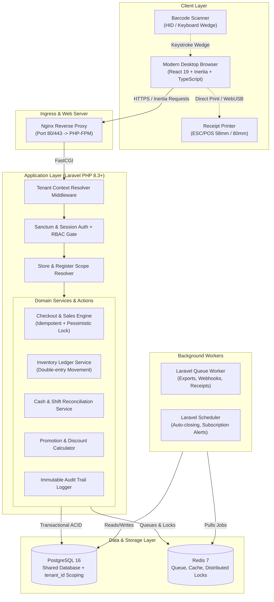

# System Architecture & Technical Design

## 1. Executive Summary

This document specifies the software architecture for the **Enterprise Multi-Tenant SaaS Point of Sale (POS)** application built with **Laravel 12**, **PostgreSQL 16**, **React 19**, **Inertia.js**, and **Docker Compose**.

The system is designed for modern retail enterprises operating across multiple legal entities (tenants), branch stores, regional warehouses, and checkout registers. It enforces strict data isolation, financial precision, deterministic inventory movement, and low-latency POS checkout workflows.

---

## 2. High-Level Architecture Overview



---

## 3. SaaS Multi-Tenancy Design

### 3.1 Multi-Tenancy Strategy: Shared Database with Discriminator (`tenant_id`)

The platform adopts the **Shared Database, Shared Schema** multi-tenancy model using `tenant_id` on every tenant-owned table:
- **Rationale**: Optimal resource utilization for thousands of retail tenants, simplified migrations, centralized schema evolution, and cost-effective hosting.
- **Isolasi Enforcements**:
  1. **Tenant Middleware**: Resolves tenant identity from authenticated session or API token (`auth()->user()->tenant_id`). The client cannot dictate or spoof `tenant_id`.
  2. **Global Query Scopes**: Handled automatically via `BelongsToTenant` trait applying `where('tenant_id', $currentTenantId)` to all Eloquent queries.
  3. **Model Event Hooks**: Automatically populates `tenant_id` on creation (`saving` / `creating` event).
  4. **PostgreSQL Row Level Security (RLS) Ready**: Schema includes RLS policy definitions that can be activated to ensure database-level defense in depth.
  5. **Cross-Tenant Attack Prevention**: Automated feature tests enforce that user $T_A$ cannot read or mutate data belonging to $T_B$.

### 3.2 Tenant Hierarchy

```text
[Platform Super Admin]
       │
       ▼
   [Tenant]  (Company / Corporate Entity, e.g., "PT Retail Jaya")
       ├── Subscription Plan & Feature Entitlements
       ├── Master Products, Categories, Units, Brands
       ├── Stores / Branches (Store A, Store B)
       │     └── Cash Registers (POS-01, POS-02)
       │           └── Active Shifts
       └── Warehouses (Main Distribution Center, Store Warehouse)
             └── Inventory Balances & Movements
```

---

## 4. Role-Based Access Control (RBAC)

The application provides granular, store-scoped and warehouse-scoped RBAC:

1. **Platform Super Admin**: Platform maintenance, tenant provisioning, subscription management, system metrics.
2. **Tenant Owner**: Full control over tenant organization, stores, warehouses, users, subscriptions, billing.
3. **Company Admin**: Operational management across all stores and warehouses within tenant.
4. **Store Manager**: Full management of designated store, store inventory, cashiers, shifts, reports.
5. **Supervisor**: Void/refund approval, discount override, cash discrepancy approval, shift audit.
6. **Cashier**: Access restricted to POS terminal, cart operations, checkout, personal shift open/close.
7. **Warehouse Staff**: Receiving purchase orders, inventory counts (stock opname), stock transfers.
8. **Sales Representative**: Order creation, customer tracking, sales commission views.
9. **Finance Staff**: Financial reports, expense tracking, supplier invoices, payment reconciliations.
10. **Auditor / Viewer**: Read-only access to audit logs, financial summaries, and inventory ledgers.

---

## 5. Transaction & Data Consistency Engine

### 5.1 Financial Math & Decimal Precision
- All monetary amounts are stored in PostgreSQL using `NUMERIC(15, 2)` (or `BIGINT` minor units).
- Floating-point calculations (`FLOAT`/`DOUBLE`) are strictly forbidden in backend business logic to prevent rounding drift.
- Tax calculation and rounding rules are executed and verified on the server side.

### 5.2 POS Checkout Concurrency & Pessimistic Locking
To prevent inventory overselling during concurrent checkout at multiple registers:
1. Every checkout request submits an `idempotency_key` (UUIDv7) generated by the client.
2. The transaction executes inside a database transaction (`DB::transaction`).
3. Inventory balances for ordered SKU items are acquired using `SELECT ... FOR UPDATE` (pessimistic row locking) to prevent race conditions.
4. If stock is insufficient and overselling is disabled, transaction rolls back immediately with HTTP 422.
5. If stock is sufficient, the `sales` record and `sale_items` are created with historical price snapshots, and `inventory_movements` are posted.

### 5.3 Double-Entry Inventory Movement Ledger
- Inventory balances are never mutated without an immutable `inventory_movements` record.
- Every adjustment, sale, return, stock opname discrepancy, and warehouse transfer produces:
  - `quantity_change` (+ or -)
  - `movement_type` (`SALE`, `PURCHASE_RECEIPT`, `TRANSFER_OUT`, `TRANSFER_IN`, `ADJUSTMENT`, `RETURN`)
  - `reference_type` and `reference_id` (e.g. `SaleItem`, `StockTransferItem`)
  - Snapshot of `unit_cost` and resultant balance.

---

## 6. Frontend & POS Architecture

### 6.1 Inertia.js + React 19 Architecture
- Server-driven routing with client-side SPA reactivity.
- Inertia shared data provides current tenant, authenticated user, active store, active shift, and flash notifications on every response.
- TypeScript strict mode enabled across all components and pages.

### 6.2 POS Viewport Design (Zero Page-Level Scroll)
```text
+--------------------------------------------------------------------------+
| Store: Megastore 01 | Reg: POS-01 | Kasir: Budi | Shift: #104 | Net: Online |
+---------------------------------------------+----------------------------+
| [ Search SKU / Barcode / Name (F2) ]        | Customer: [ Walk-in (F3) ] |
| Categories: [All] [Food] [Drink] [Retail]   |                            |
+---------------------------------------------+----------------------------+
|                                             | CART ITEMS (Scroll Area)   |
| PRODUCT GRID (Scroll Area)                  | - Kopi Arabika 250g  x2    |
| [ Card 1 ] [ Card 2 ] [ Card 3 ]            | - Teh Celup Premium  x1    |
| [ Card 4 ] [ Card 5 ] [ Card 6 ]            |                            |
|                                             |----------------------------|
|                                             | Subtotal:       Rp 120.000 |
|                                             | Diskon (0%):           Rp 0 |
|                                             | PPN (11%):       Rp 13.200 |
|                                             | GRAND TOTAL:    Rp 133.200 |
|                                             | [ BAYAR / F4 ]  [ HOLD ]   |
+---------------------------------------------+----------------------------+
```

---

## 7. Infrastructure & Docker Setup

| Service | Container Image | Port (Host / Container) | Purpose |
|---|---|---|---|
| `app` | Custom `php:8.3-fpm-alpine` | `9000` (Internal) | Laravel core execution |
| `nginx` | `nginx:alpine` | `8008:80` | Web server & static asset serving |
| `postgres` | `postgres:16-alpine` | `5433:5432` | Primary ACID relational database |
| `redis` | `redis:7-alpine` | `6381:6379` | Cache, sessions, queue, locking |
| `queue-worker` | Custom `php:8.3-fpm-alpine` | - | Background job consumer |
| `scheduler` | Custom `php:8.3-fpm-alpine` | - | Automated cron schedule dispatcher |
| `mailpit` | `axllent/mailpit` | `8025:8025` | Local SMTP capture & inspection |

*(Ports on host are chosen to avoid collision with existing local Docker services).*

