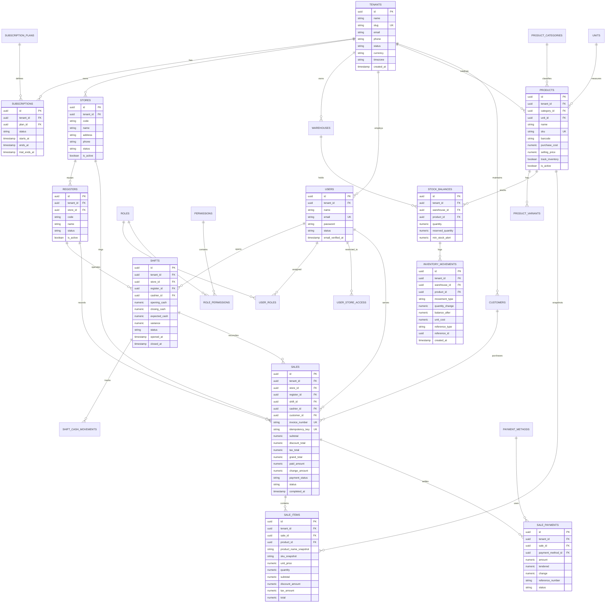

# Database Architecture & Entity Relationship Diagram (ERD)

## 1. Relational Design Principles

The database follows PostgreSQL enterprise patterns:
1. **Tenant Isolation**: Every tenant-owned table contains `tenant_id UUID NOT NULL` indexed in composite indexes.
2. **Numeric Precision**: Monetary fields use `NUMERIC(15,2)` or `NUMERIC(18,4)` for unit prices.
3. **Primary Keys**: UUIDv7 (or ULID / UUIDv4) for high-scale distributed inserts without sequence collision.
4. **Referential Integrity**: Explicit foreign key constraints with `ON DELETE RESTRICT` for financial and inventory ledgers.
5. **Auditing**: Every mutation stores `created_at`, `updated_at`, and references actor `created_by` / `updated_by`.

---

## 2. Core Entity Relationship Diagram (Mermaid)

---

## 3. Storage & Indexing Strategy

1. **Composite Indexes for Tenant Scoping**:
   - `CREATE INDEX idx_products_tenant_sku ON products (tenant_id, sku);`
   - `CREATE INDEX idx_products_tenant_barcode ON products (tenant_id, barcode);`
   - `CREATE INDEX idx_sales_tenant_store_completed ON sales (tenant_id, store_id, completed_at);`
   - `CREATE INDEX idx_inventory_tenant_warehouse_product ON stock_balances (tenant_id, warehouse_id, product_id);`
2. **Idempotency Safeguard**:
   - `CREATE UNIQUE INDEX idx_sales_idempotency ON sales (tenant_id, idempotency_key);`
3. **Financial Immutability**:
   - Deleted sales or inventory movements are disallowed. Adjustments require reverse credit notes or inverse inventory movements.

